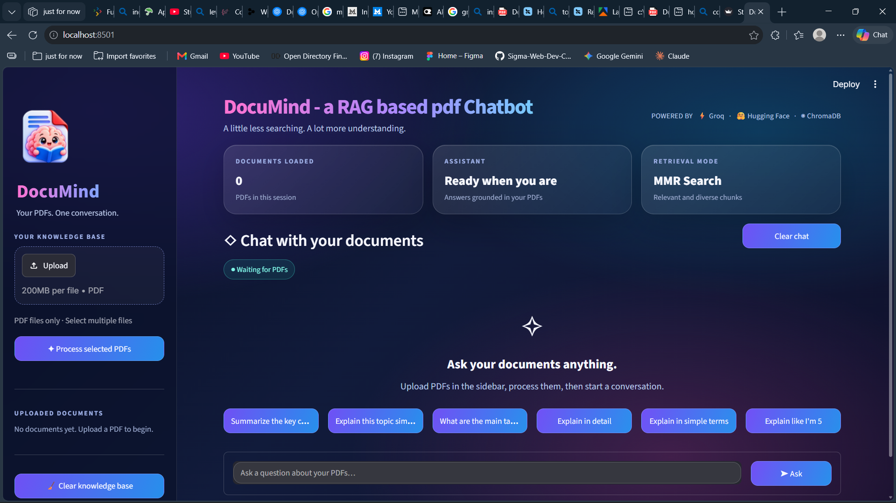
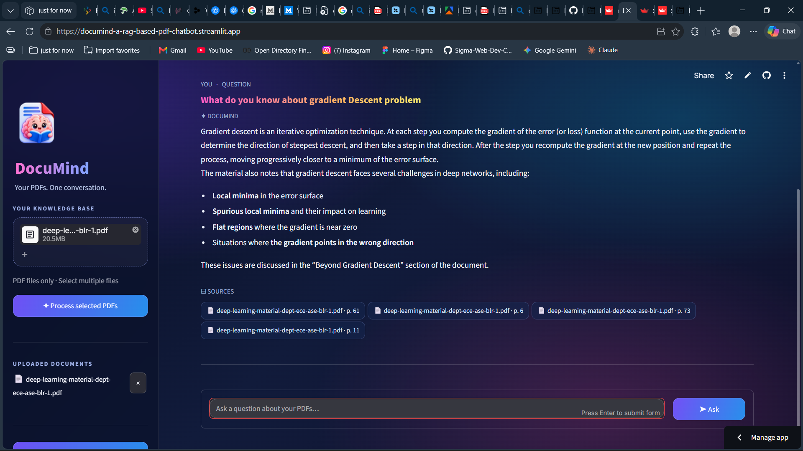

# 🧠 DocuMind

### Your PDFs. One conversation.

An AI-powered PDF question-answering assistant built with
Retrieval-Augmented Generation (RAG).

## 🚀 [OPEN DOCUMIND — LIVE APP](https://documind-a-rag-based-pdf-chatbot.streamlit.app/)


------------------------------------------------------------------------

## 📸 App Preview

Add two screenshots to the `screenshots` folder using these exact
filenames:

| DocuMind Home                                          | Chat with Your Documents                               |
|--------------------------------------------------------|--------------------------------------------------------|
|  |  |

------------------------------------------------------------------------

## ✨ About DocuMind

**DocuMind** lets you upload PDF documents and ask questions about their
contents in natural language. It retrieves relevant passages from your
documents and uses a language model to generate answers grounded in the
retrieved context.

## 🚀 Features

- PDF question answering in natural language
- Retrieval-Augmented Generation (RAG)
- Semantic text embeddings using Hugging Face Sentence Transformers
- ChromaDB vector storage and retrieval
- Maximal Marginal Relevance (MMR) retrieval
- Source filenames and page references
- Multiple PDF uploads per session
- Streamlit chat interface with a dark, glass-inspired design
- Groq API for language-model responses

## 🧰 Tech Stack

| Technology                               | Purpose                                |
|------------------------------------------|----------------------------------------|
| Python                                   | Application logic                      |
| Streamlit                                | Web interface and hosting              |
| LangChain                                | RAG and document-processing components |
| Groq API                                 | Language-model responses               |
| Hugging Face Sentence Transformers       | Text embeddings                        |
| `sentence-transformers/all-MiniLM-L6-v2` | Embedding model                        |
| ChromaDB                                 | Vector storage and retrieval           |
| PyPDF / PyPDFLoader                      | PDF text extraction                    |

## 🔄 How It Works

1.  **Upload:** Select one or more PDF files.
2.  **Extract:** Extract text from the PDFs.
3.  **Split:** Divide text into overlapping chunks.
4.  **Embed:** Convert chunks into vectors using the embedding model.
5.  **Store:** Save vectors and document chunks in ChromaDB.
6.  **Retrieve:** Retrieve relevant chunks using MMR search.
7.  **Generate:** Send the question and retrieved context to the
    Groq-hosted language model.
8.  **Display:** Show the answer and source filename/page references.

``` text
PDF Upload
    |
    v
Text Extraction -> Chunking -> Hugging Face Embeddings
                                      |
                                      v
User Question -> MMR Retriever <- ChromaDB Vector Store
                       |
                       v
              Relevant PDF Context
                       |
                       v
                    Groq LLM
                       |
                       v
             Answer + Source References
```

## 🖥️ Run Locally

### 1. Clone the repository

``` bash
git clone https://github.com/mohakmogs/DocuMind.git
cd DocuMind
```

### 2. Create and activate a virtual environment

**Windows PowerShell:**

``` powershell
python -m venv .venv
.\.venv\Scripts\Activate.ps1
```

### 3. Install dependencies

``` bash
python -m pip install --upgrade pip
pip install -r requirements.txt
```

### 4. Configure environment variables

Create a `.env` file in the project root:

``` env
GROQ_API_KEY=your_groq_api_key
GROQ_MODEL=openai/gpt-oss-120b
HF_TOKEN=your_huggingface_read_token
```

Get a Groq API key from the [Groq
Console](https://console.groq.com/keys). A Hugging Face token can be
created in [Hugging Face
settings](https://huggingface.co/settings/tokens); for this public
embedding model, it is generally optional.

**Never commit `.env` or publish API keys.** Keep `.env` in
`.gitignore`. On Streamlit Community Cloud, add credentials through the
app's **Settings → Secrets** instead.

### 5. Run the app

``` bash
streamlit run app.py
```

## ☁️ Deployment

Deploy with [Streamlit Community Cloud](https://share.streamlit.io/):

1.  Push the project to GitHub.
2.  Sign in to Streamlit Community Cloud with GitHub.
3.  Create an app and select this repository.
4.  Choose the `main` branch and set the main file path to `app.py`.
5.  Add these values under the app's **Secrets** settings:

``` toml
GROQ_API_KEY = "your_groq_api_key"
GROQ_MODEL = "openai/gpt-oss-120b"
HF_TOKEN = "your_huggingface_read_token"
```

6.  Deploy and review logs if startup fails.

The first launch may take longer while dependencies and the embedding
model are downloaded.

## 🔐 Security & Privacy

- Never commit `.env`, API keys, or access tokens.
- Store production credentials in Streamlit Secrets.
- Only upload documents you are authorized to process.
- Retrieved document context may be sent to the configured LLM provider
  to generate answers.
- This demo uses temporary/session storage for its vector database;
  uploaded files and vectors may not persist after app restarts.

## ⚠️ Limitations

- Scanned PDFs may require OCR before their contents can be searched.
- Answer quality depends on PDF text quality, chunking, retrieval, and
  the selected model.
- The initial model download and first indexing run may take time.
- Temporary Chroma storage means documents may need to be uploaded and
  processed again after a restart.

## 🗂️ Project Structure

``` text
DocuMind/
├── app.py
├── main.py
├── create_db.py
├── requirements.txt
├── .gitignore
├── img/
│   └── documind.png
├── document loaders/
├── text spitting/
└── vector store/
```

The exact contents may change as the project evolves.

## 🛠️ Troubleshooting

**`ModuleNotFoundError` during deployment**

- Confirm the missing package is listed in `requirements.txt`.
- Commit and push the updated file.
- Check the Streamlit deployment logs.

**Groq API key missing**

- Verify `GROQ_API_KEY` is configured in Streamlit Secrets.
- Ensure the app reads secrets correctly.
- Never share the key in public logs or GitHub issues.

**Slow Hugging Face download**

- The first run downloads the embedding model. Later runs may reuse the
  cache if it persists.

**Answers don't find the expected information**

- Try a text-based PDF with selectable text.
- Ask a more specific question.
- Confirm the relevant information exists in the uploaded PDF.

## 🛣️ Possible Future Improvements

- Persistent vector storage across sessions and restarts
- OCR for scanned PDFs
- Improved document removal and user isolation
- Streaming responses and clearer indexing progress
- Automated tests and additional error handling
- More embedding and LLM provider options

## 👨‍💻 Author

**Mohak Pandey**

- GitHub: [@mohakmogs](https://github.com/mohakmogs)

## 📄 License

No license is specified yet. Add a `LICENSE` file if you want to grant
others explicit permission to reuse, modify, or distribute this project.

------------------------------------------------------------------------

**DocuMind — less searching, more understanding.** 🧠📄
